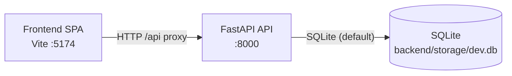

# Azure Debug Plan

> This plan is the source of truth for generating the
> VS Code debug setup in this workspace.
>
> **Status:** Approved
> **Execution Mode:** Guided
> **Created:** 2026-11-19T17:46:37+03:00
> **Last Updated:** 2026-11-19T17:46:37+03:00
>
> The workspace has no detected Azure SDKs or bindings. This plan covers local
> VS Code debugging only; it does not change or replace the existing Compose
> stack or Cloudflare configuration.

---

## Prerequisites

| Tool / Extension | Category | Service(s) | Installed | Version |
|------------------|----------|------------|-----------|---------|
| Node.js | Runtime | frontend | ✅ | 24.14.0 |
| npm | Package manager | frontend | ✅ | 11.9.0 |
| Chrome | Browser | frontend | ✅ | 158.0.8127.36 |
| Python | Runtime | backend | ✅ | 3.13.14 (`backend/.venv-backend`) |
| pip | Package manager | backend | ✅ | 26.1.2 (`backend/.venv-backend`) |
| ms-python.python | VS Code extension | backend | ✅ | 2026.10.0 |
| ms-python.debugpy | VS Code extension | backend | ✅ | 2026.6.0 |

---

## Debug Configurations

Each checked service produces a VS Code debug configuration in `.vscode/launch.json`.

| Generate | Debug Config Name | Service Label | Service Root | Project Type | Runtime | Version | Azure Dependencies |
|----------|--------------------|---------------|--------------|--------------|---------|---------|---------------------|
| [x] | Frontend (debug) | Frontend | `./` | frontend-spa | node-ts | 24.14.0 | — |
| [x] | Backend API (debug) | Backend API | `./backend` | app-service | python | 3.13 | — |
| [x] | Debug All Services | All Services | — | *Compound Config* | — | — | — |

Project Type Descriptions

| Project Type | Description |
|-------------|-------------|
| frontend-spa | Vite single-page React application |
| app-service | FastAPI HTTP application |

> ℹ️ **Proxy detected:** The Vite server proxies `/api` to the backend at `http://127.0.0.1:8000` by default. The compound configuration should start the backend before the frontend.
>
> The existing `.vscode/settings.json` is ignored by Git and contains Python-related settings. Preserve it; merge only necessary settings rather than replacing it.

---

## Orchestrator

| Orchestrator | Container Runtime | Compose Command | Description |
|-------------|-------------------|-----------------|-------------|
| Not required | — | — | Debug the frontend and backend as local processes. No Azure emulator dependencies were detected. Keep the existing `compose.yaml` unchanged; Docker Compose remains an optional, separate run path. |

---

## Emulators

No Azure SDK packages or Azure service bindings were detected. The backend defaults to local SQLite during development; PostgreSQL drivers are present for an explicitly configured `DATABASE_URL`, but no local PostgreSQL emulator is required by the default debug path.

| Dependent Service | Emulator | Purpose |
|-------------------|----------|---------|
| — | — | No Azure service emulators required |

---

## Architecture Diagram

During local debugging, Vite serves the frontend and proxies API requests to FastAPI; the backend uses SQLite by default.

---

## Migrations

Alembic migrations and dependencies are present. Automatic migration-on-launch is left unchecked because the backend currently initializes tables with SQLAlchemy `create_all()` during startup; confirm the desired schema initialization strategy before enabling both paths.

| Generate | Service | Migration Tool |
|----------|---------|---------------|
| [ ] | Backend API | Alembic |

---

## API Test Collections

| Generate | Service | Description |
|----------|---------|-------------|
| [x] | Backend API | 

HTTP Endpoints (27)
 GET / GET /api/v1/health GET /api/v1/health/db GET /api/v1/health/ready GET /api/v1/auth/me GET /api/v1/media/validate POST /api/v1/media/analyze GET /api/v1/media/{media_id}/formats GET /api/v1/downloads POST /api/v1/downloads GET /api/v1/downloads/{job_id} POST /api/v1/downloads/{job_id}/pause POST /api/v1/downloads/{job_id}/resume POST /api/v1/downloads/{job_id}/cancel POST /api/v1/downloads/{job_id}/retry DELETE /api/v1/downloads/{job_id} POST /api/v1/downloads/{job_id}/device-saved POST /api/v1/files/open-session POST /api/v1/files/download-session GET /api/v1/files/open/{ticket} GET /api/v1/library DELETE /api/v1/library/{library_id} GET /api/v1/history DELETE /api/v1/history/{history_id} DELETE /api/v1/history DELETE /api/v1/guest-session GET /api/v1/stats/overview  
 |

---

## Convenience Scripts

No new scripts are planned. Use the existing `npm run dev`, `npm test`, and `npm run typecheck` commands for the frontend; the backend can be launched directly through its VS Code debug configuration.
